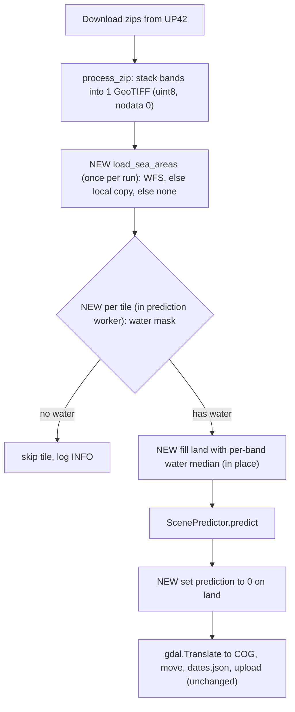

# Feature spec: Landmask

| | |
|---|---|
| Status | Implemented |
| Branch | `feature/LandMask_2026` |
| Date | 2026-10-10 |
| Code | [src/marine_litter/landmask.py](../src/marine_litter/landmask.py), PoC: [src/landmask_validation.py](../src/landmask_validation.py), [src/LandMask.ipynb](../src/LandMask.ipynb) |

## 1. Summary
The pipeline masks land in every downloaded Sentinel-2 tile before running the marine debris detector, so that
detections come only from water. Sea-area polygons (IHO Sea Areas) are fetched from the Marine Regions WFS once per
run, with a local copy as fallback. Land pixels are filled with a water-like neutral value, tiles without any water
are skipped, and the prediction is forced to 0 on land.

## 2. Background
- Today `ScenePredictor` (marinedebrisdetector) runs on whole tiles, land included. Land causes false positives
  (shown red in the GEE app) and costs GPU time.
- The PoC rasterizes the IHO "Adriatic Sea" polygon (MRGID 3314), downloaded by hand from marineregions.org, on the
  tile grid after a 250 m buffer, and sets land to 0 in all bands.
- PoC gaps that this feature closes:
  - the polygon is downloaded manually;
  - there is only one sea area, so water outside it (e.g. the Ionian Sea south of Otranto) is masked as land;
  - the whole polygon is buffered before clipping (slow, and it breaks for global polygons);
  - the whole scene is read into memory (~1.5 GB for a 10980² × 12-band tile);
  - the fill value is 0;
  - it is not wired into the pipeline.

## 3. Goals and non-goals
Goals
- G1: Get the sea-area polygons for the AOI automatically from the web, with a local copy as fallback.
- G2: Mask land in each tile before prediction, with a fill that disturbs the detector as little as possible.
- G3: Skip prediction for tiles without water.
- G4: Guarantee a prediction value of 0 on land.
- G5: Never break the pipeline. Without shape data, predict unmasked and log a warning.

Non-goals
- A more accurate coastline (e.g. OSM land polygons). See §10.
- Skipping fully masked windows inside the predictor loop. That would need our own copy of `ScenePredictor`.
- Cloud masking or model changes.

## 4. Pipeline integration


## 5. Functional requirements

### FR1: Sea areas from the web
- Source: Marine Regions GeoServer WFS, layer `MarineRegions:iho` (IHO Sea Areas), no authentication.
- Make one `GetFeature` request per pipeline run. Its `bbox` is the bounds of `ML_GEOJSON_PATH`
  (`resources/features.geojson`), expanded by 1° on each side, so that Sentinel-2 tiles (~110 km) overlapping
  the AOI edge are covered. Use EPSG:4326 lon/lat and `outputFormat=application/json`. Example:
  `https://geo.vliz.be/geoserver/MarineRegions/wfs?service=WFS&version=1.0.0&request=GetFeature&typeName=MarineRegions:iho&bbox=11.08,39.07,20.95,46.82&outputFormat=application/json`
- Verified on 2026-10-10: HTTP 200, ~17 MB, ~2 s. The response contains Adriatic Sea (3314), Ionian Sea (3351),
  Tyrrhenian Sea (3386), Mediterranean Sea – Western Basin (4279) and North Pacific Ocean (1908). The North
  Pacific polygon spans the antimeridian, so its envelope matches any bbox.
- Clip the response to the query bbox before using or caching it. This drops matches like 1908 and shrinks the file.
- Use stdlib `urllib.request` with a 60 s timeout. No new HTTP dependency.
- Treat any of these as a failed fetch: HTTP or network error, a non-JSON response, or a response with no
  features after clipping.

### FR2: Local copy and fallback
- After a successful fetch, write the clipped features (keeping `name` and `mrgid`) as GeoJSON to
  `ML_LANDMASK_PATH` (default `resources/landmask.geojson`). Write atomically: temp file plus `Path.replace`.
- If the fetch fails, log a WARNING with the reason and read `ML_LANDMASK_PATH` if it exists. Log the file's age.
- If neither is available, log a WARNING that land masking is off for this run, and run unmasked as today.
- `resources/landmask.geojson` is a runtime cache and is git-ignored. For offline setups, a GeoJSON file
  (EPSG:4326) can be placed there by hand.

### FR3: Water mask per tile
Inputs: the combined tile from `process_zip`, the sea areas, and `ML_LANDMASK_BUFFER_M`.
1. Transform the tile footprint to EPSG:4326 and expand it by a small margin. Clip the sea areas to it while
   still in EPSG:4326. Clipping first keeps the next steps cheap and avoids reprojecting global polygons.
2. Reproject the clipped geometries to the tile CRS. That CRS must be projected and in meters, which is always
   true for Sentinel-2 (UTM). Otherwise raise.
3. Buffer outward by `buffer_m`. A positive value grows the sea inland and keeps a coastal strip, because the
   IHO coastline is coarse. The PoC used 250 m.
4. Clip to the tile bounds and rasterize on the tile grid (transform, width, height) into a boolean `water` array.

Compute the mask once per tile and keep it in memory (1 byte per pixel, ~120 MB for 10980²) for FR4–FR6.

### FR4: Skip tiles without water
- A valid water pixel is one where `water` is true and the pixel is not nodata. Nodata means all bands are 0, as
  written by `process_zip`.
- A tile with no valid water pixels gets no fill and no prediction, and is logged at INFO as skipped. It produces
  no `_prediction.tif`, so it is neither in `dates.json` nor uploaded.
- The run summary reports skipped tiles separately from failed ones: `predict_litter()` raises `NoWaterError`
  for a skipped tile, while failures still return `None`.

### FR5: Fill land with a water-like neutral value
- Fill each valid land pixel with the median of the tile's own valid water pixels in the same band. Nodata
  pixels (outside the swath) stay 0.
- Why this value:
  - The detector has no model-intrinsic neutral value. It only scales its input (`* 1e-4`) and does no mean
    subtraction.
  - A fill of 0 means zero reflectance in every band, i.e. black. That puts a hard edge along the whole
    coastline, and a CNN reacts to edges within its receptive field. The water side of that edge is exactly
    where we want detections.
  - A flat area at typical water reflectance looks like calm open water to the model, and the transition at
    the coast has low contrast.
  - A per-tile median adapts to sun angle, haze and sun glint, and to the byte scaling in `process_zip`, so
    there are no constants to maintain.
  - The median is robust against ships, debris and small clouds.
- Efficiency: the combined TIFF is uint8 (uint16 is supported too, e.g. for the PoC tile), so build an exact
  median from a 256-bin (65536-bin) histogram per band (`np.bincount`). Use two passes over row blocks of the file opened `r+`: first the histograms, then the fill.
  Memory stays bounded no matter how large the tile is. The pass-1 histogram total also gives the count of
  valid water pixels for FR4.
- Modifying the combined TIFF in place is safe. It is an intermediate file in `ML_INPUT_PATH` and is never
  uploaded; the upload only reads `ML_OUTPUT_PATH`.

### FR6: Zero predictions on land
- After `ScenePredictor.predict` writes the temporary prediction and before `gdal.Translate` converts it to COG,
  set every pixel where `~water` to 0. Do this in row blocks, with the file opened `r+`.
- Use the same buffered mask as FR5, so the coastal buffer strip keeps its predictions.

### FR7: Configuration (`MLSettings`, prefix `ML_`)
| Setting | Group | Type, default | Description |
|---|---|---|---|
| `ML_LANDMASK_BUFFER_M` | Processing | `float = 250`, `ge=0` | Outward buffer of the sea areas in meters |
| `ML_LANDMASK_ENABLED` | Processing | `bool = True` | Turn land masking on or off |
| `ML_LANDMASK_PATH` | Paths | `Path = resources/landmask.geojson` | Local copy (cache and fallback) of the sea areas |

- Add `landmask_path` to the `expand_user_path` validator, and add all three settings to `.example.env`.
- The WFS URL, layer name, timeout and bbox margin are module constants, not settings.

### FR8: Logging
- Once per run, log the source used (web, local copy with its age, or none) and the names and MRGIDs of the sea
  areas.
- For each tile, log the water fraction, any skip, and the time spent masking. Log the fill values at DEBUG.

## 6. Design

### New module `src/marine_litter/landmask.py`
It replaces the PoC's `src/landmask.py`. Suggested API:
```python
def load_sea_areas(aoi_path: Path, cache_path: Path) -> gpd.GeoDataFrame | None: ...  # FR1, FR2
def water_mask(tif: Path, sea_areas: gpd.GeoDataFrame, buffer_m: float) -> np.ndarray: ...  # FR3, bool
def fill_land(tif: Path, water: np.ndarray) -> int: ...  # FR5 in place, returns number of valid water pixels
def zero_land(tif: Path, water: np.ndarray) -> None: ...  # FR6 in place
```
What to reuse from the PoC:
- From `shp_to_tif`: the reproject, clip and rasterize-on-reference-grid logic. Reorder it to clip before
  buffering, and return the array instead of writing a mask TIFF.
- `mask_fp1_using_fp2` is replaced by `fill_land`, which works in row blocks and fills with the median
  instead of 0.

### Changes to existing code
- [src/marine_litter/tif_processing.py](../src/marine_litter/tif_processing.py), `predict_litter()`:
  - Add an optional land-mask argument (the sea areas plus the buffer). `None` keeps today's behaviour.
  - Inside the worker, in this order: `water_mask` → `fill_land`, and skip if it returns 0 → predict →
    `zero_land` on the temp prediction → COG.
  - Masking runs inside the worker, so it parallelizes with `ML_PREDICT_WORKERS` and the mask is computed only
    once per tile.
- [scripts/predict_litter.py](../scripts/predict_litter.py), `main()`:
  - If `landmask_enabled` is set, call `load_sea_areas` once before the thread pool and pass the result to the
    workers. The workers only read it.
  - Report skipped tiles separately in the summary.
- [src/marine_litter/ml_settings.py](../src/marine_litter/ml_settings.py) and [.example.env](../.example.env):
  add the settings from FR7.
- [pyproject.toml](../pyproject.toml): declare `geopandas`, `numpy`, `rasterio` and `shapely` as direct
  dependencies. Before, they only came in transitively via marinedebrisdetector.
- `.gitignore`: add `resources/landmask.geojson`.
- [src/LandMask.ipynb](../src/LandMask.ipynb): use `marine_litter.landmask`, and remove `src/landmask.py`.
  [src/landmask_validation.py](../src/landmask_validation.py) stays as is (it did not import the PoC).
- [docs/index.md](../docs/index.md): add the masking step to the pipeline flowchart.

## 7. Edge cases
| Case | Behaviour |
|---|---|
| Tile fully on land | Skipped (FR4) |
| Tile fully at sea | Fill does nothing; the prediction is the same as without the mask |
| Swath edge (nodata) | Nodata stays 0 and is not used for the median |
| Water mostly under clouds | The median becomes cloud-like. Acceptable: the model knows clouds as a class, and land predictions are zeroed anyway |
| Tile outside every fetched sea area (AOI changed, margin too small) | Treated as all land and skipped. The per-run log of sea-area names makes this visible |
| WFS returns 200 with HTML or empty features | Counts as a failed fetch; the cache is not overwritten |
| Tile CRS not projected | Error for that tile (existing per-tile error handling in `predict_litter`) |

## 8. Acceptance criteria
- AC1: With network access, one run fetches the sea areas once, writes `resources/landmask.geojson`, and logs
  the sea-area names.
- AC2: Without network but with a cache, the run uses the cache and logs a WARNING. With neither, it logs a
  WARNING and the predictions match an unmasked run.
- AC3: On the test tile, every valid land pixel equals the per-band water median, water pixels are unchanged,
  and nodata stays 0.
- AC4: The prediction COG is 0 on every land pixel.
- AC5: A tile without water produces no prediction, is logged as skipped, and does not appear in `dates.json`.
- AC6: With `ML_LANDMASK_ENABLED=false`, the behaviour is exactly as today.
- AC7: Masking never holds a full-tile × all-bands array in memory; it works in row blocks.

## 9. Testing
- New `tests/test_landmask.py`, offline, using:
  - the existing fixture `combined_tif_from_up42_zip`: 1176², 12 bands, uint8, nodata 0, EPSG:32634,
    lon 17.35–18.72 / lat 41.44–42.39, on the Montenegro/Albania coast, so it contains both land and sea;
  - a new committed fixture `testdata/sea_areas_test_tile.geojson`: the IHO Adriatic polygon clipped to the
    test tile area (12 KB). The test tile's valid pixels (bottom-right corner) are all at sea, so a fixture
    cuts an island out of it to get valid land pixels.
- Cases:
  - the water fraction is strictly between 0 and 1, and a larger buffer increases it;
  - sea areas that don't touch the tile give an all-land mask;
  - `fill_land` writes the expected values and returns the right count;
  - `zero_land` sets land to 0;
  - `load_sea_areas` with a mocked `urllib.request.urlopen`:
    - success writes a clipped cache;
    - a failure falls back to the cache;
    - a failure with no cache returns `None`;
    - an empty or HTML response counts as a failure and leaves the cache untouched.
- Extend `tests/test_tif_processing.py`: predict with a land mask on CPU and check that land is 0 in the COG.
- Optional live WFS test, skipped when offline.
- Visual check on a full-size tile with `src/LandMask.ipynb` / `src/landmask_validation.py`.

## 10. Related observations (out of scope)
- **Coastline accuracy.** IHO polygons are coarse, hence the 250 m buffer. OSM land polygons
  (osmdata.openstreetmap.de, ~930 MB global, updated daily) are far more accurate. A follow-up could clip them to
  the AOI once and provide them through the same `ML_LANDMASK_PATH` fallback.

## 11. Open questions
- Is 250 m (taken from the PoC) the right default buffer? Validate it on a few full-resolution tiles with
  harbours, river mouths and islands.
- This spec fetches the sea areas on every run (~2 s, ~17 MB). Refresh only when the cache is older than N days
  if this ever becomes a burden.
